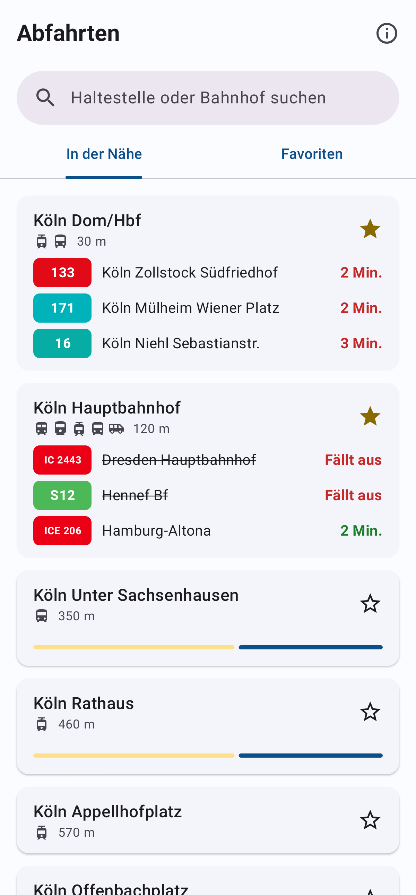

# Abfahrten – live departures for Germany

A simple Android app for German public transport, inspired by the Dutch [OVinfo](https://apps.apple.com/app/id1144468923) app: open it, see when your next bus, tram, U-Bahn, S-Bahn or train leaves, with real-time delays and cancellations. No journey planner, no account, no ads.

<p>



</p>

## Features

- **Nearby**: the closest stops with their next departures, based on your location.
- **Favourites**: star a stop; the home screen shows its next departures.
- **Departure board** per stop: countdown, platform/stop, real-time delay (green on time, red delayed), cancellations, platform changes and service alerts. Sort **by time** or **by line**, filter by mode (ICE/IC, regional, S-Bahn, U-Bahn, tram, bus…), load later departures. Refreshes every 30 s.
- **Trip view**: all stops of a trip with real-time times and where the vehicle is right now.
- **Stop search** across Germany (and the rest of Europe covered by Transitous).
- German and English, light and dark theme, Material You colours.

## Data

Timetables and real-time data come from **[Transitous](https://transitous.org)** (MOTIS 2 API, no key needed), which for Germany uses the nationwide DELFI timetable and real-time feeds. See [docs/research.md](docs/research.md) for how the Dutch OVinfo/OVapi setup compares and why Transitous was chosen over the DB APIs.

Transitous is free for **open-source, non-commercial** apps. The app follows its [usage policy](https://transitous.org/api/): it identifies itself with a User-Agent containing the repository URL, credits the [data sources](https://transitous.org/sources/) and OpenStreetMap, and keeps the request rate low.

## Install

Download `app-release.apk` (from a GitHub Actions run of this repository, or build it yourself), open it on your phone and allow installing from that source. Requires Android 8.0 or newer.

All builds are signed with the key in `keystore/shared.keystore`. It is **deliberately public**, so that every build (local, cloud, CI) can update the installed app without losing favourites. Replace it with a private key before publishing the app in a store.

## Build

Requirements: JDK 17+ and the Android SDK (platform 37.2 is downloaded automatically if your SDK licences are accepted).

```sh
./gradlew assembleRelease          # app/build/outputs/apk/release/app-release.apk
./gradlew testDebugUnitTest        # unit tests on recorded API data, offline (~10 s)
./gradlew testDebugUnitTest -PliveApi --tests '*LiveApiTest'   # checks against the real API (~15 s)
./gradlew recordRoborazziDebug -Pscreenshots   # re-render docs/screenshots/ (slow, Robolectric)
```

## Code overview

```
app/src/main/java/io/github/dnicotra/ovinfode/
├── data/api/        Transitous client (OkHttp + kotlinx.serialization) and DTOs
├── data/            Mapping to app models, repository, favourites (DataStore), location
├── util/            Countdown, line grouping, vehicle position, distances
└── ui/              Jetpack Compose screens: home, search, departures, trip, about
```

Kotlin, Jetpack Compose (Material 3), Navigation Compose, no Google Play services (location uses the platform `LocationManager`).

## License

Copyright (C) 2026 OvInfoDe contributors

Abfahrten is free software: you can redistribute it and/or modify it under the terms of the GNU General Public License as published by the Free Software Foundation, either version 3 of the License, or (at your option) any later version. It is distributed in the hope that it will be useful, but WITHOUT ANY WARRANTY; without even the implied warranty of MERCHANTABILITY or FITNESS FOR A PARTICULAR PURPOSE. See [LICENSE](LICENSE) for the full text.

The timetable data the app shows, and the recorded API responses in `app/src/test/resources/fixtures/`, are not covered by this licence: they come from Transitous and its [data sources](https://transitous.org/sources/) under their own terms.
