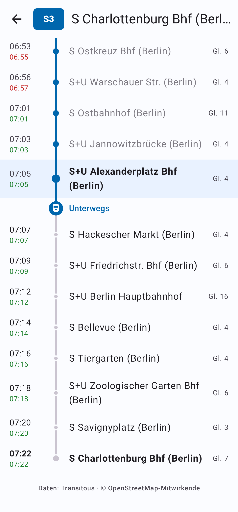
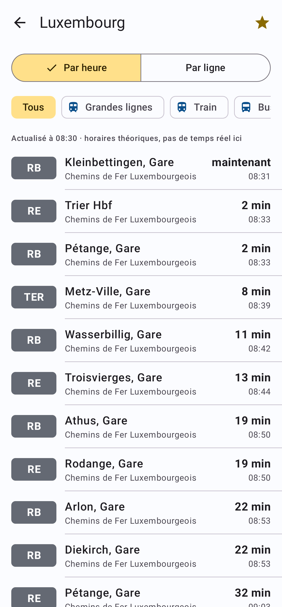

# Abfahrten – live departures for Germany, the Netherlands and Luxembourg

A simple Android app for public transport in Germany, the Netherlands and Luxembourg, inspired by the Dutch [OVinfo](https://apps.apple.com/app/id1144468923) app: open it, see when your next bus, tram, metro, S-Bahn or train leaves, with real-time delays and cancellations. No journey planner, no account, no ads.

<p>





</p>

## Features

- **Nearby**: the closest stops with their next departures, based on your location.
- **Favourites**: star a stop; the home screen shows its next departures.
- **Departure board** per stop: countdown, platform/stop, real-time delay (green on time, red delayed), cancellations, platform changes and service alerts. Sort **by time** or **by line**, filter by mode (ICE/IC, regional, S-Bahn, U-Bahn, tram, bus…), load later departures. Refreshes every 30 s.
- **Trip view**: all stops of a trip with real-time times and where the vehicle is right now.
- **Stop search** across Germany, the Netherlands and Luxembourg (and the rest of Europe covered by Transitous).
- **Local conventions per country**: German stop names shortened the DB way ("Köln Hbf"), Dutch trains as IC/SPR in NS colours, "U-Bahn" in Germany and "metro" elsewhere, GVB's bilingual alerts in one language, cross-border trains at Luxembourg station shown once under their CFL names. See [Countries](#countries).
- German, Dutch, French and English, light and dark theme, Material You colours.

## Data

Timetables and real-time data come from **[Transitous](https://transitous.org)** (MOTIS 2 API, no key needed), which uses the nationwide DELFI timetable and real-time feeds for Germany, the national [OpenOV](https://gtfs.openov.nl) feeds (NS trains and every bus, tram and metro operator) for the Netherlands, and the national timetable of the [Administration des transports publics](https://data.public.lu/en/datasets/horaires-et-arrets-des-transport-publics-gtfs/) (CFL trains, Luxtram, AVL, RGTR and TICE buses) for Luxembourg. See [docs/research.md](docs/research.md) for how the Dutch OVinfo/OVapi setup compares and why Transitous was chosen over the DB APIs and OVapi.

**Luxembourg has no real-time data in Transitous**: Luxembourg publishes it only through the mobiliteit.lu API, which needs a personal key. Boards there show timetable times (in neutral colours) and say so; only trains that a German, French or Belgian feed also carries can bring real-time data.

Transitous is free for **open-source, non-commercial** apps. The app follows its [usage policy](https://transitous.org/api/): it identifies itself with a User-Agent containing the repository URL, credits the [data sources](https://transitous.org/sources/) and OpenStreetMap, and keeps the request rate low.

## Install

Download `app-release.apk` (from a GitHub Actions run of this repository, or build it yourself), open it on your phone and allow installing from that source. Requires Android 8.0 or newer.

All builds are signed with the key in `keystore/shared.keystore`. It is **deliberately public**, so that every build (local, cloud, CI) can update the installed app without losing favourites. Replace it with a private key before publishing the app in a store.

## Build

Requirements: JDK 17+ and the Android SDK (platform 37.2 is downloaded automatically if your SDK licences are accepted).

```sh
./gradlew assembleRelease          # app/build/outputs/apk/release/app-release.apk
./gradlew testDebugUnitTest        # unit tests on recorded API data, offline (~10 s)
./gradlew testDebugUnitTest -PliveApi --tests '*LiveApiTest'   # checks against the real API (~15 s)
./gradlew recordRoborazziDebug -Pscreenshots   # re-render docs/screenshots/ (slow, Robolectric)
```

## Code overview

```
app/src/main/java/io/github/dnicotra/ovinfode/
├── data/api/        Transitous client (OkHttp + kotlinx.serialization) and DTOs
├── data/            Mapping to app models, repository, favourites (DataStore), location
├── country/         Per-country conventions (Germany, Netherlands, Luxembourg) and border outlines
├── util/            Countdown, line grouping, vehicle position, distances, stop names
└── ui/              Jetpack Compose screens: home, search, departures, trip, about
```

## Countries

Transitous covers most of Europe in one format, so the app works everywhere it has data. What differs per country is how the timetable feeds name things and what locals call them. That lives in `country/`: one object per country that overrides what it needs from `Country`:

| Rule | Germany | Netherlands | Luxembourg |
|---|---|---|---|
| Destinations without their town ("Hauptbahnhof") | looked up once, by district of the stop id | never needed: stops are "Town, Stop" | never needed: stops are "Town, Stop" ("Quarter, Stop" in the capital) |
| Line names | as in DELFI ("ICE 1697", "RE73") | "Intercity"/"Sprinter" → IC/SPR, rail replacement buses shortened, trains added in real time named from their trip id | as in the national timetable (RE, RB, IC, TER, T1, bus numbers) |
| Line colours without feed colours | generic per mode | trains in NS yellow and blue | generic per mode |
| Mode names | U-Bahn, S-Bahn | metro; all domestic trains are "train" | all CFL trains are "train" |
| Stop names | DB abbreviations (Hbf, Bf, str.) for all countries | "'s-Gravenhage" → "Den Haag" | as in the national timetable |
| Alerts | as sent | GVB's "Dutch -- English" texts split by language | none (no real-time feed) |
| Real-time data | yes | yes | no: the board says "timetable only" |

A stop's country comes from the country code in its id where there is one (German DHIDs like `de:08111:6115`, `nl:…`, `lu:…`) or from the id scheme of the country's own feed (Luxembourg's stop numbers start with a country digit: `000200405020` is in Luxembourg, `000500000079` in Germany), otherwise from simplified Natural Earth border outlines (`CountryOutlines.kt`, accurate to a kilometre or two at borders, which is not enough for Luxembourg's river towns like Vianden or Remich). Line rules follow the country of the trip's feed, so a train looks the same on every board.

A train that crosses a border is in the timetable of every country it runs in, each version named the local way and often cut off at the border: at Luxembourg station, the RE to Trier is also "RE11" to Wasserbillig in the German feed, and the TER to Nancy only goes as far as Metz in the Luxembourg one. Departures of different feeds at the same time with the same train number (or its even/odd twin, as French trains change their number where they reverse) are shown once: with the times of the version that has real-time data, the destination of the one that goes furthest, and the line name of the stop's own country.

To add a country: create an object like `Netherlands`, list it in `Countries.all`, regenerate the outlines with `python3 tools/country_outlines.py NL DE LU XX > app/src/main/java/io/github/dnicotra/ovinfode/country/CountryOutlines.kt`, add a `values-xx/strings.xml` if it speaks a new language, and record a departure board as a test fixture.

Kotlin, Jetpack Compose (Material 3), Navigation Compose, no Google Play services (location uses the platform `LocationManager`).

## License

Copyright (C) 2026 OvInfoDe contributors

Abfahrten is free software: you can redistribute it and/or modify it under the terms of the GNU General Public License as published by the Free Software Foundation, either version 3 of the License, or (at your option) any later version. It is distributed in the hope that it will be useful, but WITHOUT ANY WARRANTY; without even the implied warranty of MERCHANTABILITY or FITNESS FOR A PARTICULAR PURPOSE. See [LICENSE](LICENSE) for the full text.

The timetable data the app shows, and the recorded API responses in `app/src/test/resources/fixtures/`, are not covered by this licence: they come from Transitous and its [data sources](https://transitous.org/sources/) under their own terms. The country outlines are derived from [Natural Earth](https://www.naturalearthdata.com) (public domain).
